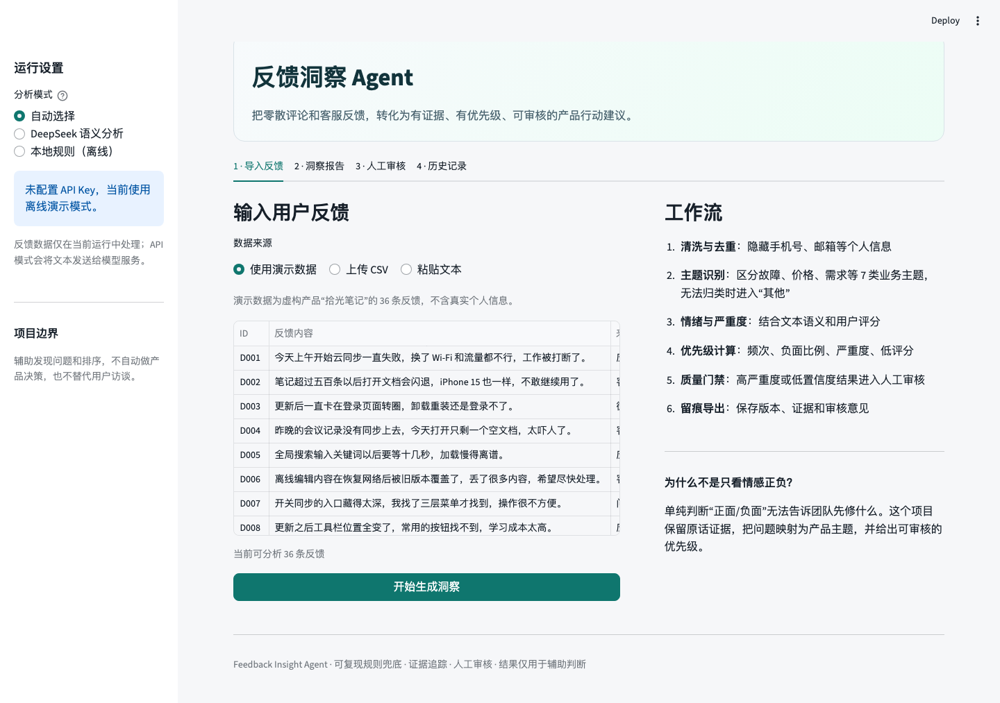
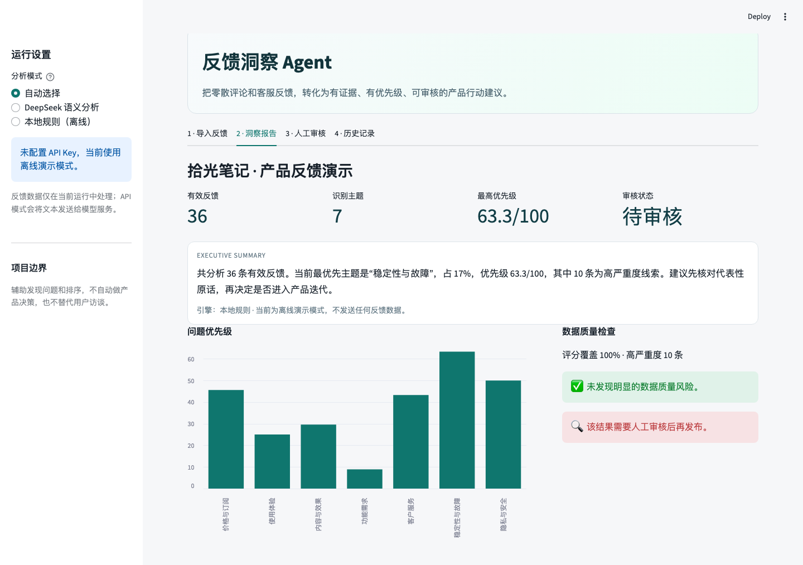
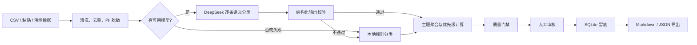

# 反馈洞察 Agent

把零散的用户评论、客服工单和问卷反馈，转化为**有证据、有优先级、可复核的产品行动建议**。



这是一个面向 AI 产品运营 / 用户运营场景的可交互作品集项目。它不满足于判断一条评论“正面还是负面”，而是完成从数据清洗、问题归类、优先级计算到人工审核和报告导出的完整工作流。

## 解决的问题

产品团队每天会收到大量非结构化反馈，但常见流程有三个问题：

- 反馈分散在应用商店、客服工单、社群和问卷中，难以形成全局视角。
- 只看情感正负，无法回答“先修什么”和“为什么值得修”。
- 大模型结论如果没有来源和人工审核，容易把个别声音放大成产品决策。

本项目使用固定主题体系、代表性原话、严重度与频率共同计算优先级，并保留人工审核记录。

## 核心能力

- **反馈导入**：支持 CSV、逐行粘贴和内置虚构演示数据。
- **清洗与脱敏**：去掉空值、重复内容和 HTML，隐藏手机号、邮箱与证件号。
- **主题洞察**：识别稳定性、体验、功能需求、价格、内容效果、客服、隐私安全等问题。
- **优先级排序**：综合反馈频次、负面比例、严重度和低评分。
- **证据追踪**：每个主题保留代表性原话、渠道和反馈 ID。
- **质量门禁**：高严重度、低样本量或低置信度结果会进入人工审核。
- **人工审核**：支持审核通过、退回修订和备注留痕。
- **版本保存**：使用 SQLite 保存每次分析结果。
- **报告导出**：支持 Markdown 和结构化 JSON。
- **离线演示**：没有 API Key 也能完整运行，不向外部服务发送数据。
- **大模型模式**：支持 OpenAI 兼容接口，默认适配 DeepSeek。

## 在线演示预览



## 快速运行

要求 Python 3.9+。

```bash
python3 -m venv .venv
source .venv/bin/activate
pip install -r requirements.txt
streamlit run app.py
```

打开 `http://localhost:8501`，保持默认的“使用演示数据”，点击“开始生成洞察”即可跑通完整流程。

### 可选：启用 DeepSeek

```bash
cp .env.example .env
```

在 `.env` 中填写：

```text
DEEPSEEK_API_KEY=your-key
```

也可以在 Streamlit Cloud 的 Secrets 中配置。模型请求失败、Key 缺失或输出未通过校验时，系统会自动回退到本地规则模式。

## CSV 格式

最小只需要一列反馈内容：

```csv
id,text,source,rating,created_at,segment
1,同步一直失败，希望尽快处理,客服工单,1,2026-10-20,付费会员
```

支持中文列名：`反馈内容`、`来源`、`评分`、`时间`、`用户类型`。完整模板见 [`data/feedback_template.csv`](data/feedback_template.csv)。

## 工作流



更详细的分层和取舍见 [`docs/architecture.md`](docs/architecture.md)。

## 评测与局限

项目包含开发集、验证集和未参与调规则的发布测试集。当前可以直接复现的是**离线规则兜底**结果，不代表 DeepSeek 模式表现。

| 数据集 | 样本数 | Accuracy | Macro F1 | 用途 |
| --- | ---: | ---: | ---: | --- |
| `eval_feedback.csv` | 44 | 100.0% | 100.0% | 开发与规则调试，不应当作泛化结论 |
| `heldout_feedback.csv` | 40 | 100.0% | 100.0% | 第二轮规则修正验证 |
| `release_test_feedback.csv` | 28 | 57.1% | 58.5% | 规则冻结后的发布测试 |

运行评测：

```bash
python3 scripts/run_eval.py data/release_test_feedback.csv
```

发布测试说明关键词规则对自然语言改写仍然脆弱，因此项目默认建议在真实使用中启用模型语义分类，并将规则作为可复现兜底。完整方法与错误分析见 [`docs/evaluation.md`](docs/evaluation.md)。

## 测试

```bash
python3 -m unittest discover -s tests -v
```

当前包含 9 个单元测试，覆盖清洗脱敏、CSV 导入、主题分类、自动兜底、SQLite 保存、人工审核和报告导出。

## 部署到 Streamlit Community Cloud

1. 将仓库推送到 GitHub，主文件保持为 `app.py`。
2. 在 [Streamlit Community Cloud](https://share.streamlit.io/) 创建应用并选择该仓库。
3. 不配置 Key 也可以使用离线演示；如需真实模型分析，在 Secrets 中加入：

```toml
DEEPSEEK_API_KEY = "your-key"
DEEPSEEK_BASE_URL = "https://api.deepseek.com"
DEEPSEEK_MODEL = "deepseek-chat"
```

Streamlit Cloud 的文件系统是临时的，免费部署中的 SQLite 历史记录可能随实例重启丢失。本项目将其作为演示功能，不作为生产数据库。

## 设计取舍

- **先完成业务闭环，再做复杂编排**：当前使用清晰的分阶段 Python 工作流，减少前端和基础设施复杂度。
- **结构化模型输出**：模型只能返回固定主题、情绪、严重度和置信度；无效响应会触发一次重试，仍失败则自动回退。
- **人工在环**：高严重度与低置信度结论不会被直接当作最终决策。
- **不自动发布**：项目只生成分析和报告，不自动向任何第三方平台发送内容。

## 已知限制

- 本地规则是演示和兜底能力，不是高精度分类器。
- 固定主题分类不等同于开放世界主题发现。
- 优先级公式是产品判断的辅助工具，不代表真实业务价值。
- 高严重度记录目前由规则识别；DeepSeek 模式下的严重度也应人工抽检。
- 当前只支持 CSV 和逐行文本，不支持直接连接工单系统。

## 项目角色

这个项目可以作为 **AI 产品运营、用户运营、AI 应用运营、解决方案运营** 岗位的作品集：重点展示需求理解、AI 工作流设计、质量评估、人工审核、版本迭代和交付意识，而不只是“调用一次大模型”。

## License

[MIT](LICENSE)

